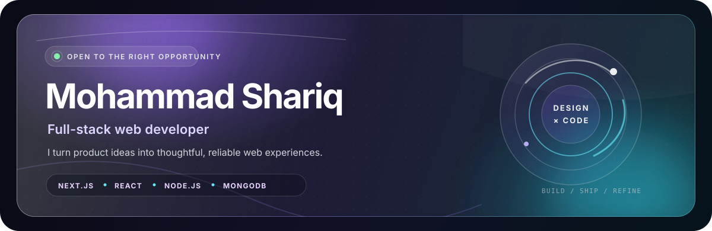
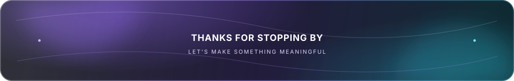

  

  

    <a href="https://shariqmohammad.vercel.app"><strong>PORTFOLIO ↗</strong></a>
    &nbsp;·&nbsp;
    <a href="https://www.linkedin.com/in/mohd-shariq-sheikh"><strong>LINKEDIN ↗</strong></a>
    &nbsp;·&nbsp;
    <a href="mailto:shariqmohd737@gmail.com"><strong>LET'S TALK ↗</strong></a>
  

  

 

## A little about how I work

I enjoy working across the stack: shaping a clear interface, building the systems behind it, and polishing the details that make a product feel considered. My focus is practical, maintainable web applications — not technology for its own sake.

  <table>
    <tr>
      <td width="50%" valign="top">
        <strong>✳ FRONTEND</strong> 
        Interfaces that feel fast, responsive, and intuitive.  
        React · Next.js · TypeScript · Tailwind CSS
      </td>
      <td width="50%" valign="top">
        <strong>⌘ BACKEND</strong> 
        APIs, authentication, data models, and application logic.  
        Node.js · Express · MongoDB · SQL
      </td>
    </tr>
    <tr>
      <td width="50%" valign="top">
        <strong>◇ PRODUCT QUALITY</strong> 
        Clean structure, reliable flows, and thoughtful details.  
        Architecture · Accessibility · Performance
      </td>
      <td width="50%" valign="top">
        <strong>↗ DELIVERY</strong> 
        Taking ideas from a working build to a live experience.  
        Git · GitHub · Vercel · Postman
      </td>
    </tr>
  </table>

## Selected work

A few areas I've explored through hands-on projects:

| Project | What it is | Focus |
|:--|:--|:--|
| **UpSkillPro** | An e-learning platform | Course experiences · Full-stack development |
| **YatraZone** | A travel booking website | Booking flows · Responsive UI |
| **Vedobi** | An e-commerce project | Product experiences · Web development |
| **Financial Accounting Book** | An accounting admin dashboard | Data management · Admin workflows |

  <a href="https://shariqmohammad.vercel.app"><strong>Explore my portfolio for project details and demos ↗</strong></a>

## Tools I reach for

  

  Also exploring: system design, clean architecture, application security, and performance optimization.

## GitHub, in brief

  <table>
    <tr>
      <td width="50%" align="center">
        
      </td>
      <td width="50%" align="center">
        
      </td>
    </tr>
  </table>
   
  

## What I'm focused on now

- Building polished full-stack products with **Next.js, React, and Node.js**.
- Improving application structure, data handling, and backend reliability.
- Making interfaces more accessible, responsive, and performant.
- Strengthening my understanding of system design and clean architecture.

## Have something in mind?

I'm open to thoughtful freelance projects, collaborative builds, and full-time opportunities involving web development.

  <a href="mailto:shariqmohd737@gmail.com"><strong>EMAIL ME ↗</strong></a>
  &nbsp;·&nbsp;
  <a href="https://shariqmohammad.vercel.app"><strong>VIEW PORTFOLIO ↗</strong></a>
  &nbsp;·&nbsp;
  <a href="https://www.linkedin.com/in/mohd-shariq-sheikh"><strong>CONNECT ↗</strong></a>
    
  

